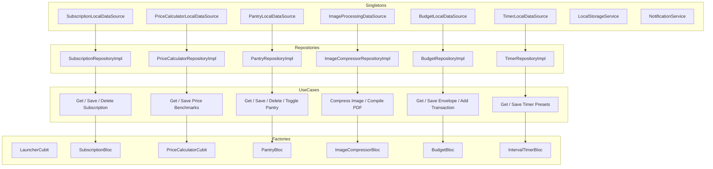
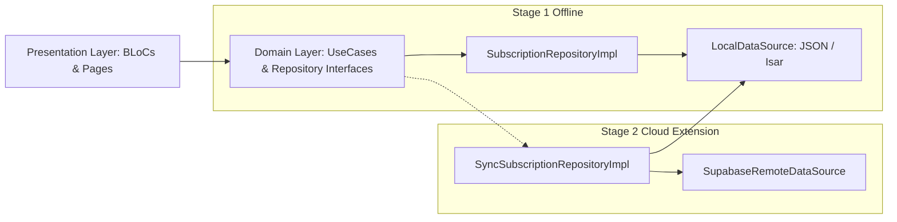

# 🗺️ DailyPouch: Comprehensive Project Architecture & Feature Map

> **App Name:** DailyPouch: Offline Life Tools  
> **App Icon Label:** DailyPouch (10 letters)  
> **Concept:** *"A small pocket container holding all my daily essentials."*  
> **Architecture:** Clean Architecture (Feature-First) with Flutter BLoC & Cubit  
> **Mode:** 100% Offline-First (Zero Cloud Dependencies, Zero Internet Permissions)  
> **Test Status:** 68/68 Tests Passing (100% Pass Rate across 24 test suites) | 0 Analyzer Issues  

---

## 📑 Table of Contents

1. [System Overview & Architecture Philosophy](#-system-overview--architecture-philosophy)
2. [Global Architecture & Layer Separation](#-global-architecture--layer-separation)
3. [Complete Directory & File Map](#-complete-directory--file-map)
4. [Service Locator & Dependency Injection Graph](#-service-locator--dependency-injection-graph)
5. [Feature-by-Feature Implementation Blueprint](#-feature-by-feature-implementation-blueprint)
   - [0. Arcade Hub Launcher](#0-arcade-hub-launcher)
   - [1. Subscription Tracker](#1-subscription-tracker)
   - [2. Smart Price Compare](#2-smart-price-compare)
   - [3. Pantry & Medicine](#3-pantry--medicine)
   - [4. IMG & PDF Compressor](#4-img--pdf-compressor)
   - [5. Single-Goal Budgeter](#5-single-goal-budgeter)
   - [6. Interval & Rest Timer](#6-interval--rest-timer)
6. [Core Shared Design System & Foundations](#-core-shared-design-system--foundations)
7. [Multi-Language Localization & Global Currency](#-multi-language-localization--global-currency)
8. [End-to-End Data Flow Lifecycle](#-end-to-end-data-flow-lifecycle)
9. [Test Suite Inventory & Verification Guide](#-test-suite-inventory--verification-guide)
10. [Stage 2 Roadmap & Future Backend Bridge](#-stage-2-roadmap--future-backend-bridge)

---

## 🏛️ System Overview & Architecture Philosophy

DailyPouch is engineered as an **offline-first, modular everyday utility suite**. Rather than a bloated monolithic application, it is designed as a small pocket container holding all daily essentials wrapped in a unified design system.

### Core Architectural Directives:
1. **Clean Architecture (Layer Separation):** Every feature is strictly separated into `domain/`, `data/`, and `presentation/` directories.
2. **The Dependency Rule:** Dependencies point inward. The `domain/` layer contains pure Dart logic (entities, repository contracts, use cases) with **zero dependencies** on Flutter UI widgets or external third-party SDKs (except `fpdart` and `equatable`).
3. **Functional Error Handling:** All asynchronous repository and use case operations return `Either<Failure, T>` using `fpdart`. Throwing uncaught exceptions across layer boundaries is strictly forbidden.
4. **Predictable State Management:** Features use either `Bloc` (for complex asynchronous event flows) or `Cubit` (for state transitions driven directly by UI callbacks).
5. **Local-First Persistence:** All persistence operates on local JSON and device file storage with thread-safe atomic operations.

---

## 📐 Global Architecture & Layer Separation

```
                       ┌───────────────────────────────┐
                       │      PRESENTATION LAYER       │
                       │  (Pages, Widgets, BLoC/Cubit) │
                       └──────────────┬────────────────┘
                                      │ Depends on
                                      ▼
                       ┌───────────────────────────────┐
                       │         DOMAIN LAYER          │
                       │   (Entities, UseCases, Repo   │
                       │          Contracts)           │
                       └──────────────▲────────────────┘
                                      │ Implements contracts
                                      │
                       ┌──────────────┴────────────────┐
                       │          DATA LAYER           │
                       │ (Models, DataSources, RepoImpl│
                       │    Local Storage, Mappers)    │
                       └───────────────────────────────┘
```

---

## 🗂️ Complete Directory & File Map

```text
e:\nestomi\
├── lib\
│   ├── main.dart                                        # Application entry point & MultiBlocProvider
│   │
│   ├── core\                                            # Cross-cutting foundational modules
│   │   ├── database\
│   │   │   └── local_storage_service.dart               # Local storage & file cache manager abstraction
│   │   ├── di\
│   │   │   └── injection_container.dart                 # GetIt service locator wiring all 6 features
│   │   ├── error\
│   │   │   ├── exceptions.dart                          # DatabaseException, CacheException, etc.
│   │   │   └── failures.dart                            # Functional Failure hierarchy (fpdart)
│   │   ├── localization\
│   │   │   ├── app_language.dart                        # Supported language enum and metadata
│   │   │   ├── app_localizations.dart                   # Type-safe localization engine (9 languages)
│   │   │   ├── locale_cubit.dart                        # Locale state management
│   │   │   └── searchable_language_picker.dart          # Instant filter modal with country flags
│   │   ├── notifications\
│   │   │   └── notification_service.dart                # Local notification scheduler wrapper
│   │   ├── theme\
│   │   │   ├── app_colors.dart                          # Pastel card backgrounds, neon accents, gradients
│   │   │   ├── app_typography.dart                      # Clean system typography & weights
│   │   │   └── app_theme.dart                           # Material 3 light/dark ThemeData configuration
│   │   ├── usecases\
│   │   │   └── usecase.dart                             # UseCase<Type, Params> generic interface
│   │   └── widgets\
│   │       ├── custom_app_bar.dart                      # Reusable header with module accent glows
│   │       ├── glass_card.dart                          # Frosted glass card with neon borders
│   │       └── responsive_layout.dart                   # Multi-column grid builder for tablet/desktop
│   │
│   └── features\                                        # Feature-first modular utilities
│       ├── launcher\                                    # ARCADE HUB LAUNCHER
│       │   ├── domain\entities\utility_module.dart      # Static metadata for all 6 tools
│       │   ├── presentation\
│       │   │   ├── cubit\launcher_cubit.dart            # Category filter & search query state
│       │   │   ├── pages\launcher_page.dart             # Responsive 2-column arcade dashboard
│       │   │   └── widgets\
│       │   │       ├── arcade_module_card.dart          # Snug side-by-side card with 3D illustration
│       │   │       ├── module_3d_illustrations.dart     # Custom isometric 3D vector artwork
│       │   │       └── settings_about_modal.dart        # Language & central currency settings
│       │
│       ├── subscription_tracker\                        # MODULE 1: SUBSCRIPTION TRACKER
│       │   ├── domain\
│       │   │   ├── entities\subscription_entity.dart    # SubscriptionEntity, billing cycles, burn rate
│       │   │   ├── repositories\subscription_repository.dart
│       │   │   └── usecases\
│       │   │       ├── get_subscriptions_usecase.dart
│       │   │       ├── save_subscription_usecase.dart
│       │   │       └── delete_subscription_usecase.dart
│       │   ├── data\
│       │   │   ├── datasources\subscription_local_datasource.dart
│       │   │   ├── models\subscription_model.dart
│       │   │   └── repositories\subscription_repository_impl.dart
│       │   └── presentation\
│       │       ├── bloc\
│       │       │   ├── subscription_event.dart
│       │       │   ├── subscription_state.dart
│       │       │   └── subscription_bloc.dart
│       │       ├── pages\subscription_page.dart
│       │       └── widgets\
│       │           ├── burn_rate_card.dart              # Monthly outflow & annual burn summary
│       │           ├── subscription_tile.dart           # Subscription item with countdown & badge
│       │           └── add_edit_subscription_dialog.dart# Entry modal with cycle picker
│       │
│       ├── price_calculator\                            # MODULE 2: SMART PRICE COMPARE
│       │   ├── domain\
│       │   │   ├── entities\comparison_item_entity.dart # Unit normalizer (100g, 1kg, 100ml, 1L, count)
│       │   │   ├── repositories\price_calculator_repository.dart
│       │   │   └── usecases\
│       │   │       ├── get_saved_benchmarks_usecase.dart
│       │   │       └── save_benchmark_usecase.dart
│       │   ├── data\
│       │   │   ├── datasources\price_calculator_local_datasource.dart
│       │   │   ├── models\saved_benchmark_model.dart
│       │   │   └── repositories\price_calculator_repository_impl.dart
│       │   └── presentation\
│       │       ├── cubit\
│       │       │   ├── price_calculator_cubit.dart      # Real-time multi-item comparison
│       │       │   └── price_calculator_state.dart
│       │       ├── pages\price_calculator_page.dart
│       │       └── widgets\
│       │           ├── best_deal_banner.dart            # Highlight banner for the top value option
│       │           └── comparison_item_card.dart        # Option input card with unit selector
│       │
│       ├── pantry_expiry\                               # MODULE 3: PANTRY & MEDICINE
│       │   ├── domain\
│       │   │   ├── entities\pantry_item_entity.dart     # StorageZone & FreshnessStatus (Safe/Warning/Expired)
│       │   │   ├── repositories\pantry_repository.dart
│       │   │   └── usecases\
│       │   │       ├── get_pantry_items_usecase.dart
│       │   │       ├── save_pantry_item_usecase.dart
│       │   │       ├── delete_pantry_item_usecase.dart
│       │   │       └── toggle_consumed_usecase.dart
│       │   ├── data\
│       │   │   ├── datasources\pantry_local_datasource.dart
│       │   │   ├── models\pantry_item_model.dart
│       │   │   └── repositories\pantry_repository_impl.dart
│       │   └── presentation\
│       │       ├── bloc\
│       │       │   ├── pantry_event.dart
│       │       │   ├── pantry_state.dart
│       │       │   └── pantry_bloc.dart
│       │       ├── pages\pantry_expiry_page.dart
│       │       └── widgets\
│       │           ├── expiry_status_badge.dart         # Color-coded freshness pill
│       │           ├── pantry_item_tile.dart            # Item card with quick consume check
│       │           └── add_edit_pantry_item_dialog.dart # Modal with quick grocery presets
│       │
│       ├── expense_tracker\                             # MODULE 4: ALL-IN-ONE EXPENSE TRACKER
│       │   ├── domain\
│       │   │   ├── entities\
│       │   │   │   ├── expense_category.dart            # Expense & income categories with icons/colors
│       │   │   │   └── expense_transaction.dart         # ExpenseTransaction, TimePeriodFilter, FinancialSummary
│       │   │   ├── repositories\expense_repository.dart
│       │   │   └── usecases\expense_usecases.dart       # Get, Save, Delete, GetSummary usecases
│       │   ├── data\
│       │   │   ├── datasources\expense_local_datasource.dart # Persistent JSON store (expenses_store.json)
│       │   │   ├── models\expense_transaction_model.dart
│       │   │   └── repositories\expense_repository_impl.dart
│       │   └── presentation\
│       │       ├── bloc\
│       │       │   ├── expense_event.dart
│       │       │   ├── expense_state.dart
│       │       │   └── expense_bloc.dart
│       │       ├── pages\expense_tracker_page.dart      # Main dashboard with period filters & search
│       │       └── widgets\
│       │           ├── spending_summary_card.dart       # Net balance, income/expense split, savings rate
│       │           ├── category_breakdown_view.dart     # Category spending progress distribution
│       │           ├── transaction_list_tile.dart       # Feed tile with quick actions
│       │           └── add_edit_transaction_sheet.dart  # Modal for logging income/expenses
│       │
│       ├── micro_budgeter\                              # MODULE 5: SINGLE-GOAL BUDGETER
│       │   ├── domain\
│       │   │   ├── entities\budget_envelope_entity.dart # Envelope with daily runway math & transactions
│       │   │   ├── repositories\budget_repository.dart
│       │   │   └── usecases\
│       │   │       ├── get_envelopes_usecase.dart
│       │   │       ├── save_envelope_usecase.dart
│       │   │       ├── delete_envelope_usecase.dart
│       │   │       ├── add_transaction_usecase.dart
│       │   │       └── get_transactions_usecase.dart
│       │   ├── data\
│       │   │   ├── datasources\budget_local_datasource.dart
│       │   │   ├── models\budget_envelope_model.dart
│       │   │   ├── models\expense_transaction_model.dart
│       │   │   └── repositories\budget_repository_impl.dart
│       │   └── presentation\
│       │       ├── bloc\
│       │       │   ├── budget_event.dart
│       │       │   ├── budget_state.dart
│       │       │   └── budget_bloc.dart
│       │       ├── pages\micro_budgeter_page.dart
│       │       └── widgets\
│       │           ├── runway_gauge_card.dart           # Visual daily spending pace gauge
│       │           ├── quick_log_modal.dart             # Instant 1-tap (+5, +10, +25, +50) spend logger
│       │           └── add_edit_envelope_dialog.dart   # Goal duration & target fund dialog
│       │
│       └── interval_timer\                              # MODULE 6: INTERVAL & REST TIMER
│           ├── domain\
│           │   ├── entities\interval_preset_entity.dart # Tabata, HIIT, Boxing, Stretch presets
│           │   ├── repositories\timer_repository.dart
│           │   └── usecases\timer_usecases.dart         # GetTimerPresets & SaveTimerPreset
│           │   ├── data\
│           │   │   ├── datasources\timer_local_datasource.dart
│           │   │   ├── models\interval_preset_model.dart
│           │   │   └── repositories\timer_repository_impl.dart
│           │   └── presentation\
│           │       ├── bloc\
│           │       │   ├── interval_timer_event.dart
│           │       │   ├── interval_timer_state.dart
│           │       │   └── interval_timer_bloc.dart     # Periodic ticker & Wakelock engine
│           │       ├── pages\interval_timer_page.dart
│           │       └── widgets\
│           │           ├── timer_countdown_gauge.dart   # High-contrast circular progress ring
│           │           ├── interval_controls_bar.dart   # Reset / Play / Pause / Skip controls
│           │           ├── preset_selector_carousel.dart# Horizontal routine selector
│           │           └── edit_preset_dialog.dart      # Custom interval routine builder
│
└── test\                                                # 68 AUTOMATED TESTS (24 TEST SUITES)
    ├── core\
    │   ├── localization\app_localizations_test.dart
    │   └── theme\app_theme_test.dart
    ├── widget_test.dart                                 # End-to-end launcher navigation test
    └── features\
        ├── launcher\launcher_cubit_test.dart
        ├── subscription_tracker\
        │   ├── domain\usecases\get_subscriptions_usecase_test.dart
        │   ├── data\repositories\subscription_repository_impl_test.dart
        │   ├── presentation\bloc\subscription_bloc_test.dart
        │   └── presentation\widgets\subscription_localization_test.dart
        ├── price_calculator\
        │   ├── domain\unit_conversion_test.dart
        │   ├── presentation\cubit\price_calculator_cubit_test.dart
        │   └── presentation\price_calculator_localization_test.dart
        ├── pantry_expiry\
        │   ├── domain\expiry_calculation_test.dart
        │   ├── presentation\bloc\pantry_bloc_test.dart
        │   └── presentation\pantry_localization_test.dart
        ├── expense_tracker\
        │   ├── domain\expense_calculation_test.dart
        │   ├── data\expense_transaction_model_test.dart
        │   ├── presentation\bloc\expense_bloc_test.dart
        │   └── presentation\expense_tracker_localization_test.dart
        ├── micro_budgeter\
        │   ├── domain\runway_calculation_test.dart
        │   ├── presentation\bloc\budget_bloc_test.dart
        │   └── presentation\budget_localization_test.dart
        └── interval_timer\
            ├── domain\timer_math_test.dart
            ├── presentation\bloc\interval_timer_bloc_test.dart
            └── presentation\timer_localization_test.dart
```

---

## 💉 Service Locator & Dependency Injection Graph

Dependency Injection is configured in [lib/core/di/injection_container.dart](file:///e:/nestomi/lib/core/di/injection_container.dart) using `get_it`.



---

## 🔬 Feature-by-Feature Implementation Blueprint

### 0. Arcade Hub Launcher
- **Purpose:** Central responsive dashboard with snug side-by-side card layouts, custom 3D isometric vector artwork, search filtering, and settings access.
- **Card Sizing Metrics:** 1-line bold titles (`14.5px`), subtitles (`11.5px`), `52px` 3D illustration, and aspect ratio `1.38` (mobile) / `1.62` (tablet/desktop).
- **State Management:** `LauncherCubit` manages search query filter and category selection (`all`, `finance`, `kitchen`, `media`, `fitness`).

---

### 1. Subscription Tracker
- **Purpose:** Eliminate subscription creep by monitoring recurring bills, monthly/annual burn rates, renewal countdowns, and paid/unpaid tracking.
- **Domain Logic:**
  - `SubscriptionEntity.monthlyAmount`: Converts yearly (`cost / 12`) and weekly (`cost * 52 / 12`) bills into standard monthly burn.
  - `SubscriptionEntity.daysUntilNextBilling`: Calculates remaining days until next scheduled renewal.
- **Data Layer:** `SubscriptionLocalDataSourceImpl` persists subscriptions atomically to `subscriptions_store.json`.
- **Presentation:**
  - `BurnRateCard`: Shows total monthly outflow and annualized cost.
  - `SubscriptionTile`: Color-coded billing cycle tags and category icons.

---

### 2. Smart Price Compare
- **Purpose:** Instantly calculate true unit costs across multi-packs, bulk sizes, and metric/imperial variations.
- **Domain Logic:**
  - `MeasurementUnit`: Normalizes weights to **100g / 1kg**, volumes to **100ml / 1L**, and counts to **1pc / 100pcs**.
  - `PriceComparisonResult`: Identifies the exact Best Deal item, Worst Deal item, and calculates precise percentage savings (`(worstPrice - bestPrice) / worstPrice * 100`).
- **3D Illustration:** Isometric Pack A & Pack B crowned with an enlarged "BEST DEAL" badge.

---

### 3. Pantry & Medicine
- **Purpose:** Prevent food waste and track medicine shelf-life across distinct storage zones (Fridge, Freezer, Pantry, Medicine Cabinet).
- **Domain Logic:**
  - `StorageZone`: `fridge`, `freezer`, `pantry`, `medicine`, `all`.
  - `FreshnessStatus`:
    - 🟢 `Safe`: Expiry is > 5 days away.
    - 🟡 `Warning`: Expiry is <= 5 days away.
    - 🔴 `Expired`: Expiry is in the past.
- **3D Illustration:** Isometric fresh milk carton and two-tone pharmaceutical capsule bridged with a green checkmark badge.

---

### 4. IMG & PDF Compressor
- **Purpose:** Zero-cloud on-device image resizing and document PDF compilation for web portals, visas, and job applications.
- **Domain Logic:**
  - `CompressionPreset`:
    - `targetKb200`: Target < 200 KB (job/visa portals).
    - `targetKb100`: Ultra compact < 100 KB.
    - `passportPhoto`: 2x2 inches (600x600 px center crop).
    - `signatureStrip`: 400x150 px wide crop.
    - `a4Document`: 1240x1754 px letter scan.
- **Data Layer:**
  - Utilizes pure Dart `package:image` for in-memory bitmap transformation and iterative quality compression.
  - Utilizes `package:pdf` for assembling multiple images into a multi-page A4 document.

---

### 5. Single-Goal Budgeter
- **Purpose:** Isolated envelope budgeter for specific events (vacations, parties, dining out) that calculates a live daily spending allowance.
- **Domain Logic:**
  - `BudgetEnvelopeEntity.dailyRunwayAllowance`: `(targetAmount - spentAmount) / remainingDays`.
  - `BudgetEnvelopeEntity.burnProgressPercentage`: Pacing indicator for visual gauge.
- **Data Layer:** `budget_envelopes_store.json` & `budget_transactions_store.json`.
- **Presentation:**
  - `RunwayGaugeCard`: Displays safe daily allowance and timeline progress.
  - `QuickLogModal`: 1-tap fast expenditure logger (+5, +10, +25, +50 buttons with category tags).

---

### 6. Interval & Rest Timer
- **Purpose:** High-contrast interval and rest timer for HIIT, Tabata, Boxing rounds, and stretching routines.
- **Domain Logic:**
  - `IntervalPresetEntity`: Holds prep, work, rest, sets, and cooldown durations. Standard defaults included (Tabata 20/10, HIIT 45/15, Boxing 180/60, Stretch 60/20).
- **Engine & State:**
  - `IntervalTimerBloc`: Drives a `Timer.periodic` stream with phase state transitions (`prepare` -> `work` -> `rest` -> `cooldown` -> `completed`).
  - Screen wake-lock managed via `WakelockPlus.enable()` and `WakelockPlus.disable()`.
- **3D Illustration:** Isometric electric-indigo heavy dumbbell with knurled metallic bar paired with a gold-crowned digital interval timer.

---

## 🌐 Multi-Language Localization & Global Currency

1. **Supported Languages (9):**
   - 🇬🇧 English (`en`)
   - 🇧🇩 Bengali (`bn`)
   - 🇪🇸 Spanish (`es`)
   - 🇫🇷 French (`fr`)
   - 🇩🇪 German (`de`)
   - 🇮🇳 Hindi (`hi`)
   - 🇸🇦 Arabic (`ar`)
   - 🇨🇳 Simplified Chinese (`zh`)
   - 🇯🇵 Japanese (`ja`)

2. **Localized Number & Date Formatting:**
   - Native digit mapping (Bengali `০-৯`, Arabic `٠-٩`).
   - Month translations and localized relative day strings (`In 3 Days`, `Due Today`, `Overdue by 2 Days`).

3. **Central Currency Selector:**
   - Configurable from Settings dialog and dynamically applied across Subscription Tracker, Price Compare, and Budgeter.

---

## 🧪 Test Suite Inventory & Verification Guide

### Running the Complete Test Suite:
```bash
flutter test
```

### Complete Test Inventory (68 Automated Tests):
| Test File | Tests | Coverage Scope |
| :--- | :--- | :--- |
| `test/widget_test.dart` | 1 | End-to-end launcher rendering, navigation, and settings modal |
| `test/core/localization/app_localizations_test.dart` | 3 | Multi-language translation integrity and relative date strings |
| `test/features/launcher/launcher_cubit_test.dart` | 4 | Search queries, category filters, reset state |
| `test/features/subscription_tracker/domain/usecases/get_subscriptions_usecase_test.dart` | 2 | Subscription repository delegation |
| `test/features/subscription_tracker/data/repositories/subscription_repository_impl_test.dart` | 3 | Data source serialization & DatabaseFailure handling |
| `test/features/subscription_tracker/presentation/bloc/subscription_bloc_test.dart` | 4 | Initial state, load success, delete, error emissions |
| `test/features/subscription_tracker/presentation/widgets/subscription_localization_test.dart` | 3 | Localized currency symbols & Bengali burn rate |
| `test/features/price_calculator/domain/unit_conversion_test.dart` | 4 | Weight (g/kg), Volume (ml/L), Count math & best deal identification |
| `test/features/price_calculator/presentation/cubit/price_calculator_cubit_test.dart` | 3 | Real-time input updates & dynamic savings computation |
| `test/features/price_calculator/presentation/price_calculator_localization_test.dart` | 3 | Localized best deal banners & unit pricing labels |
| `test/features/pantry_expiry/domain/expiry_calculation_test.dart` | 4 | Safe, Warning (<=5 days), and Expired status assertions |
| `test/features/pantry_expiry/presentation/bloc/pantry_bloc_test.dart` | 4 | Load items, add item, toggle consumed, error states |
| `test/features/expense_tracker/domain/expense_calculation_test.dart` | 3 | Net cash flow, surplus/deficit, savings rate percentage & category sums |
| `test/features/expense_tracker/data/expense_transaction_model_test.dart` | 3 | JSON serialization, deserialization & entity conversions |
| `test/features/expense_tracker/presentation/bloc/expense_bloc_test.dart` | 4 | Load, save, delete, period filters & live transaction search |
| `test/features/expense_tracker/presentation/expense_tracker_localization_test.dart` | 3 | Multi-language translation across 9 supported languages |
| `test/features/micro_budgeter/domain/runway_calculation_test.dart` | 4 | Daily runway allowance, burn progress, overbudget edge cases |
| `test/features/micro_budgeter/presentation/bloc/budget_bloc_test.dart` | 4 | Load envelopes, add transactions, delete envelope |
| `test/features/micro_budgeter/presentation/budget_localization_test.dart` | 3 | Daily allowance gauge and transaction labels |
| `test/features/interval_timer/domain/timer_math_test.dart` | 4 | Workout duration formulas, zero rest handling, set math |
| `test/features/interval_timer/presentation/bloc/interval_timer_bloc_test.dart` | 5 | Periodic ticker, phase transitions, pause/reset |
| `test/features/interval_timer/presentation/timer_localization_test.dart` | 3 | Preset routine names and phase text translations |

---

## 🔮 Stage 2 Roadmap & Future Backend Bridge

When the decision is made to implement **Stage 2 (Cloud Sync & Supabase Backend)**, the Clean Architecture design ensures zero breaking changes to UI or domain logic:



### Transition Steps:
1. **Create Remote Data Sources:** Implement `SupabaseRemoteDataSource` in `lib/features/*/data/datasources/remote/`.
2. **Implement Sync Repositories:** Modify `RepositoryImpl` to write locally first (offline-first), then queue synchronization with Supabase when online.
3. **Zero UI/Domain Refactoring:** Use cases and BLoC presentation layers will require **0 code changes**, interacting exclusively with the abstract repository contracts in `domain/`.
