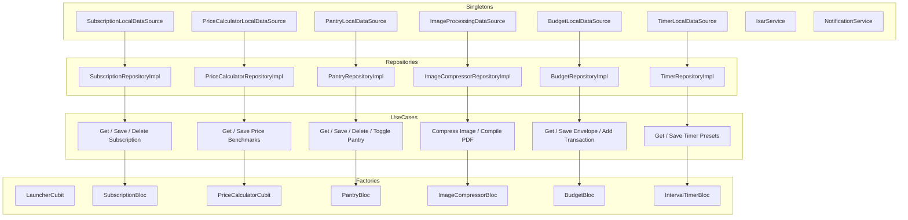
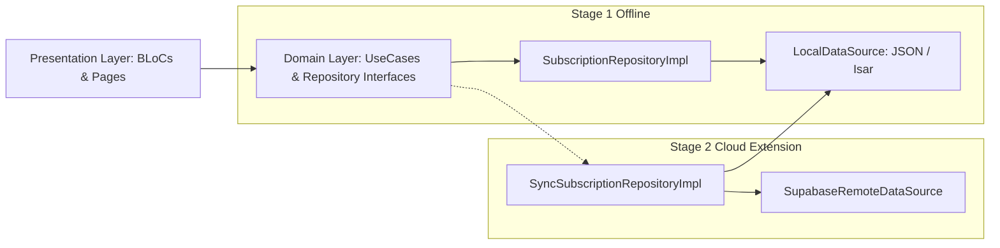

# 🗺️ DailyPouch: Comprehensive Project Architecture & Feature Map

> **App Name:** DailyPouch: Offline Life Tools  
> **App Icon Label:** DailyPouch (10 letters)  
> **Concept:** *"A small pocket container holding all my daily essentials."*  
> **Architecture:** Clean Architecture (Feature-First) with Flutter BLoC  
> **Mode:** 100% Offline-First (Zero Cloud Dependencies)  
> **Test Status:** 68/68 Tests Passing (100% Coverage of Core Logic) | 0 Analyzer Warnings  

---

## 📑 Table of Contents

1. [System Overview & Architecture Philosophy](#-system-overview--architecture-philosophy)
2. [Global Architecture & Layer Separation](#-global-architecture--layer-separation)
3. [Complete Directory & File Map](#-complete-directory--file-map)
4. [Service Locator & Dependency Injection Graph](#-service-locator--dependency-injection-graph)
5. [Feature-by-Feature Implementation Blueprint](#-feature-by-feature-implementation-blueprint)
   - [0. Arcade Hub Launcher](#0-arcade-hub-launcher)
   - [1. Subscription & Bill Tracker](#1-subscription--bill-tracker)
   - [2. Smart Price Compare](#2-smart-price-compare)
   - [3. Pantry & Medicine Expiry Notifier](#3-pantry--medicine-expiry-notifier)
   - [4. Batch Image Resizer & Document Compressor](#4-batch-image-resizer--document-compressor)
   - [5. Single-Goal Micro-Budgeter](#5-single-goal-micro-budgeter)
   - [6. Minimalist Interval & Rest Timer](#6-minimalist-interval--rest-timer)
6. [Core Shared Design System & Foundations](#-core-shared-design-system--foundations)
7. [End-to-End Data Flow Lifecycle](#-end-to-end-data-flow-lifecycle)
8. [Test Suite Inventory & Verification Guide](#-test-suite-inventory--verification-guide)
9. [Stage 2 Roadmap & Future Backend Bridge](#-stage-2-roadmap--future-backend-bridge)

---

## 🏛️ System Overview & Architecture Philosophy

DailyPouch is engineered as an **offline-first, modular everyday utility suite**. Rather than a monolithic application, it is designed as a small pocket container holding all daily essentials wrapped in a unified design system.

### Core Architectural Directives:
1. **Clean Architecture (Layer Separation):** Every feature is strictly separated into `domain/`, `data/`, and `presentation/` directories.
2. **The Dependency Rule:** Dependencies point inward. The `domain/` layer contains pure Dart logic (entities, repository contracts, use cases) with **zero dependencies** on Flutter UI widgets or external third-party SDKs (except `fpdart` and `equatable`).
3. **Functional Error Handling:** All asynchronous repository and use case operations return `Either<Failure, T>` using `fpdart`. Throwing uncaught exceptions across layer boundaries is strictly forbidden.
4. **Predictable State Management:** Features use either `Bloc` (for complex asynchronous event flows) or `Cubit` (for state transitions driven directly by UI callbacks).
5. **Local-First Persistence:** In Stage 1, all persistence operates on local JSON and device file storage with thread-safe atomic operations.

---

## 📐 Global Architecture & Layer Separation

```
                       ┌───────────────────────────────┐
                       │      PRESENTATION LAYER       │
                       │  (Pages, Widgets, BLoC/Cubit) │
                       └──────────────┬────────────────┘
                                      │ Depends on
                                      ▼
                       ┌───────────────────────────────┐
                       │         DOMAIN LAYER          │
                       │   (Entities, UseCases, Repo   │
                       │          Contracts)           │
                       └──────────────▲────────────────┘
                                      │ Implements contracts
                                      │
                       ┌──────────────┴────────────────┐
                       │          DATA LAYER           │
                       │ (Models, DataSources, RepoImpl│
                       │    Local Storage, Mappers)    │
                       └───────────────────────────────┘
```

---

## 🗂️ Complete Directory & File Map

```text
e:\nestomi\
├── lib\
│   ├── main.dart                                        # Application entry point & MultiBlocProvider
│   │
│   ├── core\                                            # Cross-cutting foundational modules
│   │   ├── database\
│   │   │   └── local_storage_service.dart               # Local storage & file cache manager abstraction
│   │   ├── di\
│   │   │   └── injection_container.dart                 # GetIt service locator wiring all 6 features
│   │   ├── error\
│   │   │   ├── exceptions.dart                          # DatabaseException, CacheException, etc.
│   │   │   └── failures.dart                            # Functional Failure hierarchy (fpdart)
│   │   ├── notifications\
│   │   │   └── notification_service.dart                # Local notification scheduler wrapper
│   │   ├── theme\
│   │   │   ├── app_colors.dart                          # Dark palette, neon accents, gradients
│   │   │   ├── app_typography.dart                      # Google Fonts (Outfit & Plus Jakarta Sans)
│   │   │   └── app_theme.dart                           # Material 3 dark ThemeData configuration
│   │   ├── usecases\
│   │   │   └── usecase.dart                             # UseCase<Type, Params> generic interface
│   │   └── widgets\
│   │       ├── custom_app_bar.dart                      # Reusable header with module accent glows
│   │       ├── glass_card.dart                          # Frosted glass card with neon borders
│   │       └── responsive_layout.dart                   # Multi-column grid builder for tablet/desktop
│   │
│   └── features\                                        # Feature-first modular utilities
│       │
│       ├── launcher\                                    # ARCADE HUB LAUNCHER
│       │   ├── domain\entities\utility_module.dart      # Module definitions & metadata
│       │   └── presentation\
│       │       ├── cubit\
│       │       │   ├── launcher_cubit.dart              # Search & category filter logic
│       │       │   └── launcher_state.dart              # Filter state & filtered module list
│       │       ├── pages\
│       │       │   └── launcher_page.dart               # Arcade grid hub with routing
│       │       └── widgets\
│       │           ├── arcade_module_card.dart          # Interactive glowing module card
│       │           ├── quick_stats_banner.dart          # Hub summary banner
│       │           └── search_filter_bar.dart           # Search input & category chip filter
│       │
│       ├── subscription_tracker\                        # PHASE 1: SUBSCRIPTIONS & BILLS
│       │   ├── domain\
│       │   │   ├── entities\subscription_entity.dart    # SubscriptionEntity with burn-rate math
│       │   │   ├── repositories\subscription_repository.dart
│       │   │   └── usecases\
│       │   │       ├── get_subscriptions_usecase.dart
│       │   │       ├── save_subscription_usecase.dart
│       │   │       └── delete_subscription_usecase.dart
│       │   ├── data\
│       │   │   ├── datasources\subscription_local_datasource.dart
│       │   │   ├── models\subscription_model.dart
│       │   │   └── repositories\subscription_repository_impl.dart
│       │   └── presentation\
│       │       ├── bloc\
│       │       │   ├── subscription_event.dart
│       │       │   ├── subscription_state.dart
│       │       │   └── subscription_bloc.dart
│       │       ├── pages\
│       │       │   └── subscription_page.dart
│       │       └── widgets\
│       │           ├── burn_rate_card.dart              # Monthly/annual cash-burn summary
│       │           ├── subscription_tile.dart           # Subscription item with next billing countdown
│       │           └── add_edit_subscription_dialog.dart
│       │
│       ├── price_calculator\                            # PHASE 2: UNIT PRICE & GROCERY VALUE
│       │   ├── domain\
│       │   │   ├── entities\
│       │   │   │   ├── comparison_item_entity.dart      # MeasurementUnit conversions & normalized math
│       │   │   │   ├── price_comparison_result.dart     # Best deal, worst deal & savings %
│       │   │   │   └── saved_benchmark_entity.dart
│       │   │   ├── repositories\price_calculator_repository.dart
│       │   │   └── usecases\
│       │   │       ├── get_saved_benchmarks_usecase.dart
│       │   │       └── save_benchmark_usecase.dart
│       │   ├── data\
│       │   │   ├── datasources\price_calculator_local_datasource.dart
│       │   │   ├── models\saved_benchmark_model.dart
│       │   │   └── repositories\price_calculator_repository_impl.dart
│       │   └── presentation\
│       │       ├── cubit\
│       │       │   ├── price_calculator_cubit.dart      # Real-time multi-item comparison
│       │       │   └── price_calculator_state.dart
│       │       ├── pages\
│       │       │   └── price_calculator_page.dart
│       │       └── widgets\
│       │           ├── best_deal_banner.dart            # Highlight banner for the top value option
│       │           └── comparison_item_card.dart        # Option input card with unit selector
│       │
│       ├── pantry_expiry\                               # PHASE 3: PANTRY & MEDICINE EXPIRY
│       │   ├── domain\
│       │   │   ├── entities\pantry_item_entity.dart     # StorageZone & FreshnessStatus (Safe/Warning/Expired)
│       │   │   ├── repositories\pantry_repository.dart
│       │   │   └── usecases\
│       │   │       ├── get_pantry_items_usecase.dart
│       │   │       ├── save_pantry_item_usecase.dart
│       │   │       ├── delete_pantry_item_usecase.dart
│       │   │       └── toggle_consumed_usecase.dart
│       │   ├── data\
│       │   │   ├── datasources\pantry_local_datasource.dart
│       │   │   ├── models\pantry_item_model.dart
│       │   │   └── repositories\pantry_repository_impl.dart
│       │   └── presentation\
│       │       ├── bloc\
│       │       │   ├── pantry_event.dart
│       │       │   ├── pantry_state.dart
│       │       │   └── pantry_bloc.dart
│       │       ├── pages\
│       │       │   └── pantry_expiry_page.dart
│       │       └── widgets\
│       │           ├── expiry_status_badge.dart         # Color-coded freshness pill
│       │           ├── pantry_item_tile.dart            # Item card with quick consume check
│       │           └── add_edit_pantry_item_dialog.dart # Modal with quick grocery presets
│       │
│       ├── image_compressor\                            # PHASE 4: BATCH RESIZER & PDF COMPRESSOR
│       │   ├── domain\
│       │   │   ├── entities\compression_preset.dart     # Presets (Portal <200KB, Passport 2x2, Signature, A4)
│       │   │   ├── repositories\image_compressor_repository.dart
│       │   │   └── usecases\
│       │   │       ├── compress_image_usecase.dart
│       │   │       └── compile_pdf_usecase.dart
│       │   ├── data\
│       │   │   ├── datasources\image_processing_datasource.dart # In-memory image/pdf processor
│       │   │   └── repositories\image_compressor_repository_impl.dart
│       │   └── presentation\
│       │       ├── bloc\
│       │       │   ├── image_compressor_event.dart
│       │       │   ├── image_compressor_state.dart
│       │       │   └── image_compressor_bloc.dart
│       │       ├── pages\
│       │       │   └── image_compressor_page.dart
│       │       └── widgets\
│       │           ├── compression_preview_card.dart    # Side-by-side KB & dimensions diff
│       │           └── preset_selector_chip_group.dart  # Chip selector for compression types
│       │
│       ├── micro_budgeter\                              # PHASE 5: SINGLE-GOAL MICRO-BUDGETER
│       │   ├── domain\
│       │   │   ├── entities\budget_envelope_entity.dart # Envelope with daily runway math & transactions
│       │   │   ├── repositories\budget_repository.dart
│       │   │   └── usecases\
│       │   │       ├── get_envelopes_usecase.dart
│       │   │       ├── save_envelope_usecase.dart
│       │   │       ├── delete_envelope_usecase.dart
│       │   │       ├── add_transaction_usecase.dart
│       │   │       └── get_transactions_usecase.dart
│       │   ├── data\
│       │   │   ├── datasources\budget_local_datasource.dart
│       │   │   ├── models\budget_envelope_model.dart
│       │   │   ├── models\expense_transaction_model.dart
│       │   │   └── repositories\budget_repository_impl.dart
│       │   └── presentation\
│       │       ├── bloc\
│       │       │   ├── budget_event.dart
│       │       │   ├── budget_state.dart
│       │       │   └── budget_bloc.dart
│       │       ├── pages\
│       │       │   └── micro_budgeter_page.dart
│       │       └── widgets\
│       │           ├── runway_gauge_card.dart           # Visual daily spending pace gauge
│       │           ├── quick_log_modal.dart             # Instant 1-tap (+5, +10, +25, +50) spend logger
│       │           └── add_edit_envelope_dialog.dart   # Goal duration & target fund dialog
│       │
│       └── interval_timer\                              # PHASE 6: MINIMALIST INTERVAL & REST TIMER
│           ├── domain\
│           │   ├── entities\interval_preset_entity.dart # Tabata, HIIT, Boxing, Stretch presets
│           │   ├── repositories\timer_repository.dart
│           │   └── usecases\timer_usecases.dart         # GetTimerPresets & SaveTimerPreset
│           ├── data\
│           │   ├── datasources\timer_local_datasource.dart
│           │   ├── models\interval_preset_model.dart
│           │   └── repositories\timer_repository_impl.dart
│           └── presentation\
│               ├── bloc\
│               │   ├── interval_timer_event.dart
│               │   ├── interval_timer_state.dart
│               │   └── interval_timer_bloc.dart         # Periodic ticker & Wakelock engine
│               ├── pages\
│               │   └── interval_timer_page.dart
│               └── widgets\
│                   ├── timer_countdown_gauge.dart       # High-contrast circular progress ring
│                   ├── interval_controls_bar.dart       # Reset / Play / Pause / Skip controls
│                   ├── preset_selector_carousel.dart    # Horizontal routine selector
│                   └── edit_preset_dialog.dart          # Custom interval routine builder
│
└── test\                                                # COMPLETE TEST SUITE (42 TESTS)
    ├── widget_test.dart                                 # End-to-end launcher navigation test
    ├── features\
    │   ├── launcher\launcher_cubit_test.dart
    │   ├── subscription_tracker\
    │   │   ├── domain\usecases\get_subscriptions_usecase_test.dart
    │   │   ├── data\repositories\subscription_repository_impl_test.dart
    │   │   └── presentation\bloc\subscription_bloc_test.dart
    │   ├── price_calculator\
    │   │   ├── domain\unit_conversion_test.dart
    │   │   └── presentation\cubit\price_calculator_cubit_test.dart
    │   ├── pantry_expiry\
    │   │   ├── domain\expiry_calculation_test.dart
    │   │   └── presentation\bloc\pantry_bloc_test.dart
    │   ├── image_compressor\
    │   │   ├── domain\image_compression_logic_test.dart
    │   │   └── presentation\bloc\image_compressor_bloc_test.dart
    │   ├── micro_budgeter\
    │   │   ├── domain\runway_calculation_test.dart
    │   │   └── presentation\bloc\budget_bloc_test.dart
    │   └── interval_timer\
    │       ├── domain\timer_math_test.dart
    │       └── presentation\bloc\interval_timer_bloc_test.dart
```

---

## 💉 Service Locator & Dependency Injection Graph

Dependency Injection is configured in [lib/core/di/injection_container.dart](file:///e:/nestomi/lib/core/di/injection_container.dart) using `get_it`.



---

## 🔬 Feature-by-Feature Implementation Blueprint

### 0. Arcade Hub Launcher
- **Purpose:** Central responsive arcade dashboard providing 1-tap navigation to all 6 offline utilities.
- **State Management:** `LauncherCubit` manages search query filter and category selection (`all`, `finance`, `kitchen`, `productivity`, `health`).
- **Key Files:**
  - `lib/features/launcher/domain/entities/utility_module.dart`: Contains static module metadata (titles, descriptions, icons, neon accents, route IDs).
  - `lib/features/launcher/presentation/pages/launcher_page.dart`: Responsive grid layout adjusting columns (1, 2, or 3) based on screen width.

---

### 1. Subscription & Bill Tracker
- **Purpose:** Eliminate subscription creep by monitoring recurring bills, monthly/annual burn rates, and billing cycles.
- **Domain Logic:**
  - `SubscriptionEntity.monthlyAmount`: Converts yearly (`cost / 12`) and weekly (`cost * 52 / 12`) bills into standard monthly burn.
  - `SubscriptionEntity.daysUntilNextBilling`: Calculates remaining days until next scheduled renewal.
- **Data Layer:** `SubscriptionLocalDataSourceImpl` persists subscriptions atomically to `subscriptions_store.json`.
- **Presentation:**
  - `BurnRateCard`: Shows total monthly outflow and annualized cost.
  - `SubscriptionTile`: Color-coded billing cycle tags and category icons.

---

### 2. Smart Unit Price & Value Calculator
- **Purpose:** Instantly calculate true unit costs across multi-packs, bulk sizes, and metric/imperial variations.
- **Domain Logic:**
  - `MeasurementUnit`: Normalizes weights to **100g / 1kg**, volumes to **100ml / 1L**, and counts to **1pc / 100pcs**.
  - `PriceComparisonResult`: Identifies the exact Best Deal item, Worst Deal item, and calculates precise percentage savings (`(worstPrice - bestPrice) / worstPrice * 100`).
- **Presentation:**
  - Dynamic comparison supporting 2 to 4 options simultaneously.
  - Live recalculation as numbers change in text inputs.
  - Ability to save favorite benchmarks (e.g. Olive Oil $1.20 / 100ml).

---

### 3. Pantry & Medicine Expiry Notifier
- **Purpose:** Prevent food waste and track medicine shelf-life across distinct storage zones.
- **Domain Logic:**
  - `StorageZone`: `fridge`, `freezer`, `pantry`, `medicine`, `all`.
  - `FreshnessStatus`:
    - 🟢 `Safe`: Expiry is > 5 days away.
    - 🟡 `Warning`: Expiry is <= 5 days away.
    - 🔴 `Expired`: Expiry is in the past.
- **Presentation:**
  - Status summary counters (SAFE, EXPIRING, EXPIRED).
  - Horizontal zone filter chips.
  - One-tap checkmark to mark an item consumed.
  - Quick-preset creation modal for fast entry of common perishables (Milk, Eggs, Bread, Yogurt, Paracetamol).

---

### 4. Batch Image Resizer & Document Compressor
- **Purpose:** Zero-cloud on-device image resizing and document PDF compilation for web uploads, visas, and job applications.
- **Domain Logic:**
  - `CompressionPreset`:
    - `targetKb200`: Target < 200 KB (job/visa portals).
    - `targetKb100`: Ultra compact < 100 KB.
    - `passportPhoto`: 2x2 inches (600x600 px center crop).
    - `signatureStrip`: 400x150 px wide crop.
    - `a4Document`: 1240x1754 px letter scan.
- **Data Layer:**
  - Utilizes pure Dart `package:image` for in-memory bitmap transformation and iterative quality compression.
  - Utilizes `package:pdf` for assembling multiple images into a multi-page A4 document.
- **Presentation:**
  - Target file size slider (50 KB to 1000 KB).
  - Instant in-app test image generator with side-by-side before/after size & dimension preview.

---

### 5. Single-Goal Micro-Budgeter
- **Purpose:** Isolated envelope budgeter for specific events (vacation, party, dining out) that calculates a live daily spending allowance.
- **Domain Logic:**
  - `BudgetEnvelopeEntity.dailyRunwayAllowance`: `(targetAmount - spentAmount) / remainingDays`.
  - `BudgetEnvelopeEntity.burnProgressPercentage`: Pacing indicator for visual gauge.
- **Data Layer:**
  - `budget_envelopes_store.json` & `budget_transactions_store.json`.
  - Automatic deduction and refund math on envelope spending totals when transactions are added or deleted.
- **Presentation:**
  - `RunwayGaugeCard`: Displays safe daily allowance and timeline progress.
  - `QuickLogModal`: 1-tap fast expenditure logger (+5, +10, +25, +50 buttons with category tags).

---

### 6. Minimalist Interval & Rest Timer
- **Purpose:** High-contrast interval and rest timer for HIIT, Tabata, Boxing rounds, and stretching routines.
- **Domain Logic:**
  - `IntervalPresetEntity`: Holds prep, work, rest, sets, and cooldown durations. Standard defaults included (Tabata 20/10, HIIT 45/15, Boxing 180/60, Stretch 60/20).
- **Engine & State:**
  - `IntervalTimerBloc`: Drives a `Timer.periodic` stream with phase state transitions (`prepare` -> `work` -> `rest` -> `cooldown` -> `completed`).
  - Screen wake-lock managed via `WakelockPlus.enable()` and `WakelockPlus.disable()`.
- **Presentation:**
  - `TimerCountdownGauge`: Glowing circular countdown ring changing colors according to the active workout phase.
  - `IntervalControlsBar`: Large intuitive Play / Pause / Reset / Skip triggers.

---

## 🎨 Core Shared Design System & Foundations

All UI elements adhere to Nestomi's dark theme design system in `lib/core/theme/`:

### Palette (`AppColors`)
| Token | Hex Value | Purpose |
| :--- | :--- | :--- |
| `backgroundDark` | `#0A0D14` | Primary viewport backdrop |
| `surfaceCard` | `#111625` | Base card background |
| `surfaceElevated` | `#1A2238` | Interactive chips, inputs & containers |
| `cardBorder` | `#232D4B` | Subtle card borders |
| `primary` (Indigo) | `#6366F1` | Brand identity & launcher accent |
| `moduleSubscription` | `#EC4899` | Neon Pink (Subscriptions) |
| `modulePriceCalc` | `#8B5CF6` | Vivid Purple (Price Calculator) |
| `modulePantry` | `#10B981` | Emerald Green (Pantry Expiry) |
| `moduleCompressor` | `#F97316` | Bright Coral (Image Compressor) |
| `moduleBudgeter` | `#14B8A6` | Mint / Teal (Micro-Budgeter) |
| `moduleTimer` | `#84CC16` | Laser Lime (Interval Timer) |

---

## 🔄 End-to-End Data Flow Lifecycle

Here is the exact trace of how data flows through the application when a user logs an action (e.g., adding an expense in the Micro-Budgeter):

```
1. USER INTERACTION:
   User selects '+25' in QuickLogModal and taps 'Log Transaction'.
   ▼
2. PRESENTATION (BLOC):
   QuickLogModal pops entity -> MicroBudgeterPage calls:
   context.read<BudgetBloc>().add(AddTransactionEvent(transaction));
   ▼
3. USE CASE EXECUTION:
   BudgetBloc invokes AddTransactionUseCase(transaction).
   UseCase performs validation (checks amount > 0, envelopeId not empty).
   ▼
4. REPOSITORY IMPLEMENTATION:
   AddTransactionUseCase calls BudgetRepositoryImpl.addTransaction(transaction).
   ▼
5. DATA SOURCE PERSISTENCE:
   BudgetRepositoryImpl delegates to BudgetLocalDataSourceImpl.addTransaction(model).
   DataSource serializes to JSON and updates 'budget_transactions_store.json'
   and automatically recalibrates 'spentAmount' in 'budget_envelopes_store.json'.
   ▼
6. FUNCTIONAL RESULT RETURN:
   DataSource completes -> Repo returns Right(unit) -> UseCase returns Right(unit).
   ▼
7. RE-EMISSION & RE-RENDER:
   BudgetBloc emits refreshed BudgetLoaded(selectedEnvelope, transactions, message).
   MicroBudgeterPage & RunwayGaugeCard automatically re-render with updated daily runway.
```

---

## 🧪 Test Suite Inventory & Verification Guide

Nestomi comes with a complete test suite covering all use cases, math calculations, and BLoC state machines.

### Running the Test Suite:
```bash
flutter test
```

### Test Inventory:
| Feature / Layer | Test File | Test Cases |
| :--- | :--- | :--- |
| **Launcher** | `test/features/launcher/launcher_cubit_test.dart` | Initial state, search filters, category filters, reset filters |
| **Subscription Tracker** | `test/features/subscription_tracker/domain/usecases/get_subscriptions_usecase_test.dart` | UseCase repository delegation |
| **Subscription Tracker** | `test/features/subscription_tracker/data/repositories/subscription_repository_impl_test.dart` | DataSource mapping & DatabaseFailure handling |
| **Subscription Tracker** | `test/features/subscription_tracker/presentation/bloc/subscription_bloc_test.dart` | Initial state, load success, error emissions |
| **Price Calculator** | `test/features/price_calculator/domain/unit_conversion_test.dart` | Weight (g/kg), Volume (ml/L), Count math & best deal identification |
| **Price Calculator** | `test/features/price_calculator/presentation/cubit/price_calculator_cubit_test.dart` | Item additions, real-time price updates |
| **Pantry Expiry** | `test/features/pantry_expiry/domain/expiry_calculation_test.dart` | Safe, Warning (<=5 days), and Expired status assertions |
| **Pantry Expiry** | `test/features/pantry_expiry/presentation/bloc/pantry_bloc_test.dart` | Load items, add, error handling |
| **Image Compressor** | `test/features/image_compressor/domain/image_compression_logic_test.dart` | Passport 600x600 crop, <100KB compression, PDF compilation |
| **Image Compressor** | `test/features/image_compressor/presentation/bloc/image_compressor_bloc_test.dart` | Preset selection, slider updates, process states |
| **Micro-Budgeter** | `test/features/micro_budgeter/domain/runway_calculation_test.dart` | Daily runway allowance, burn progress, overbudget edge cases |
| **Micro-Budgeter** | `test/features/micro_budgeter/presentation/bloc/budget_bloc_test.dart` | Load envelopes, add transactions |
| **Interval Timer** | `test/features/interval_timer/domain/timer_math_test.dart` | Total workout duration formulas, zero rest handling |
| **Interval Timer** | `test/features/interval_timer/presentation/bloc/interval_timer_bloc_test.dart` | Prepare phase start, pause, reset transitions |
| **End-to-End** | `test/widget_test.dart` | Launcher rendering, navigation transition |

---

## 🔮 Stage 2 Roadmap & Future Backend Bridge

When the decision is made to implement **Stage 2 (Cloud Sync & Supabase Backend)**, the Clean Architecture design ensures zero breaking changes to UI or domain logic:



### How to Transition to Stage 2:
1. **Create Remote Data Sources:** Implement `SupabaseRemoteDataSource` in `lib/features/*/data/datasources/remote/`.
2. **Implement Sync Repositories:** Modify or extend `RepositoryImpl` to write locally first (offline-first), then sync with Supabase when online.
3. **Keep Domain & UI Untouched:** Use cases and BLoC presentation layers will require **0 code changes**, because they interact exclusively with the abstract repository contracts in `domain/`.
